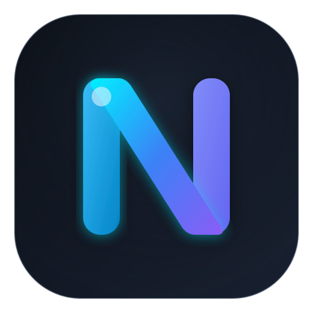
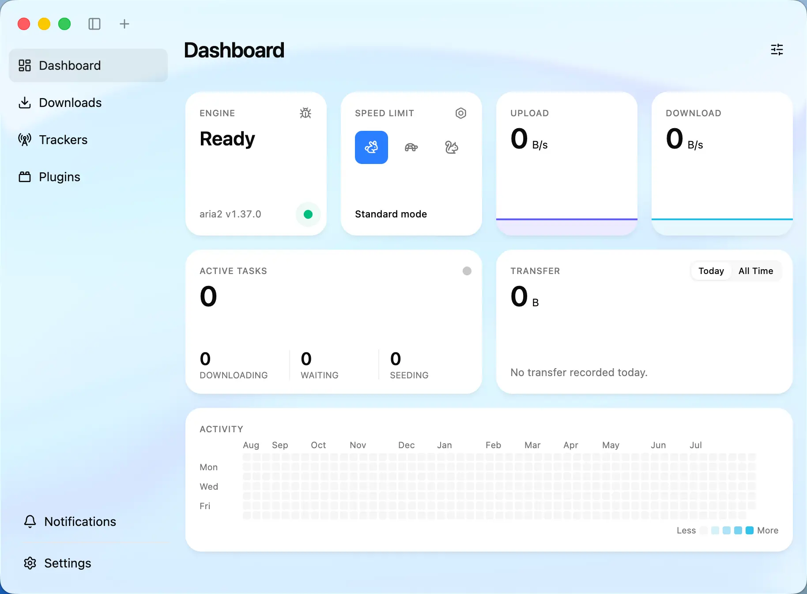
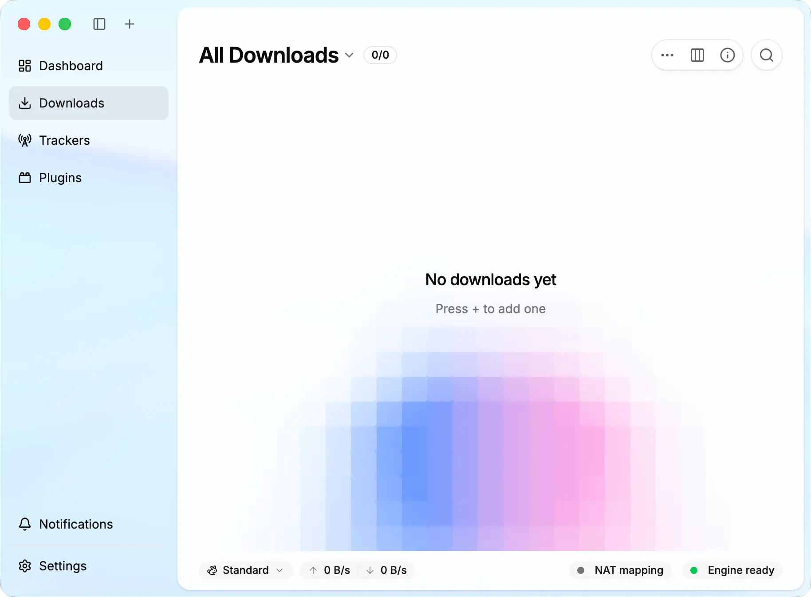
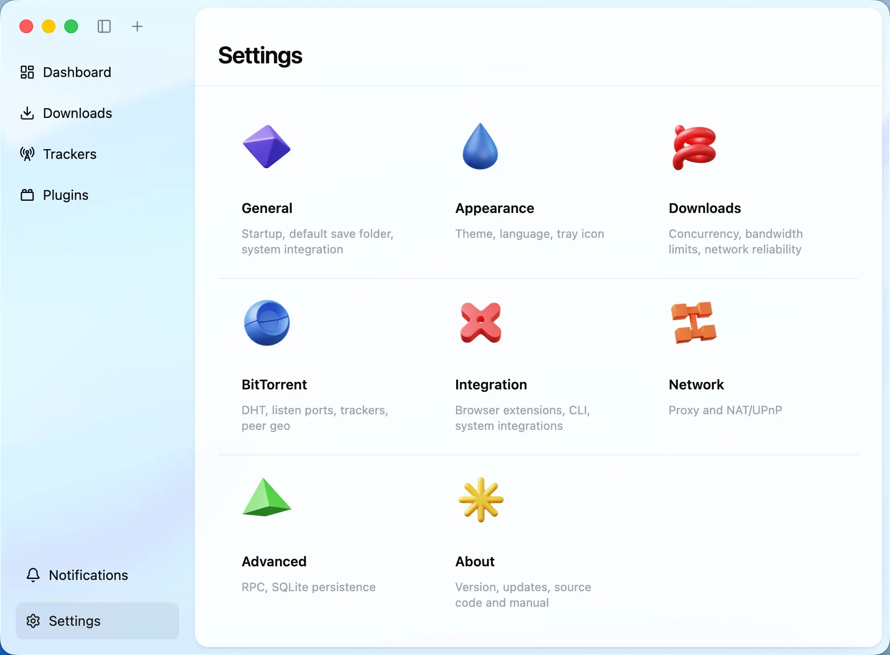

<div>
  
  <h1>Nio Downloader</h1>
  <p>A modern, full-featured download manager that stays simple to use</p>
</div>

[](https://github.com/NotUrNio/Nio-Downloader/releases)

## Overview

Nio Downloader is a clean, full-featured desktop download manager for HTTP, FTP, BitTorrent, magnet links, and more.

Rebuilt from the ground up with Electron, React, and TypeScript, Nio Downloader pairs modern performance with a clean, straightforward user experience. The download core is independent of the UI. Browser extensions and command-line tools communicate with the app over **MDXP** (Download eXchange Protocol), an open protocol built on JSON-RPC 2.0, while plugins run in isolated sandboxes.

The same core powers two ways to run Nio Downloader:

- **Desktop app:** Runs on macOS, Windows, and Linux
- **Headless server:** Runs without a desktop environment, either directly on Node.js or in Docker, and includes a web UI for NAS devices and home servers

## 🧪 Beta testing

Nio Downloader is currently in beta. Download the latest release from [GitHub Releases](https://github.com/NotUrNio/Nio-Downloader/releases) and read the release notes before installing.

Back up your existing downloads and data before testing. When practical, test in parallel using a separate OS account, machine, or Docker data directory.

## Screenshots

### Dashboard

<picture>
  <source media="(prefers-color-scheme: dark)" srcset="./screenshots/nio-dashboard-dark.webp">
  <source media="(prefers-color-scheme: light)" srcset="./screenshots/nio-dashboard-en-light.webp">
  
</picture>

### Downloads

<picture>
  <source media="(prefers-color-scheme: dark)" srcset="./screenshots/nio-downloads-en-dark.webp">
  <source media="(prefers-color-scheme: light)" srcset="./screenshots/nio-downloads-en-light.webp">
  
</picture>

### Settings

<picture>
  <source media="(prefers-color-scheme: dark)" srcset="./screenshots/nio-settings-en-dark.webp">
  <source media="(prefers-color-scheme: light)" srcset="./screenshots/nio-settings-en-light.webp">
  
</picture>

## ✨ Features

- 🕹 Clean, intuitive interface with dark mode
- 🦄 BitTorrent downloads with per-file selection, plus magnet link support
- 📡 Built-in tracker list management with automatic updates and health checks
- 🔌 UPnP and NAT-PMP port mapping
- 🚥 Upload and download limits with multiple speed-limit profiles
- 💾 SQLite-backed sessions that restore downloads after a restart
- 📊 Customizable Dashboard with transfer stats, live activity, and task tiles
- 🔔 System notifications when downloads finish, plus an in-app notification center
- 🧩 QuickJS-based plugin sandboxing, fine-grained permissions, and an in-app marketplace
- 🌐 [Nio Downloader Extension](https://github.com/NotUrNio/Nio-Downloader-Extension) for Chrome, Edge, Firefox, and Safari hands browser downloads off in one click
- ⌨️ Official `@nio/cli` client for everyday shell use and AI agents
- 🐳 Docker-ready headless server with secure device-code pairing for remote CLI and agent clients
- 🎬 Extensible URL Resolver plugins for extracting media from supported sites
- 🤖 System tray integration and launch at startup
- 🌍 Multi-language UI with internationalization support
- 🔗 Handlers for `nio://` and `magnet:` links, plus `.torrent` file associations

## 🧩 Ecosystem

Nio Downloader extends beyond the desktop app with a shared protocol library, command-line client, browser extensions, and a complete plugin toolchain:

| Project | Distribution | What it does |
|---------|--------------|--------------|
| `@nio/mdxp` | npm package | Defines the shared JSON-RPC 2.0 wire schemas and Zod types for MDXP, with helpers for bidirectional connections |
| `@nio/cli` | npm package | Provides the `nio` command, automatically discovers a local desktop app, and pairs with remote instances |
| [Nio Downloader Extension](https://github.com/NotUrNio/Nio-Downloader-Extension) | Browser extension | Intercepts downloads in Chrome, Edge, Opera, Firefox, and Safari (Manifest V3), hands them off to Nio Downloader, and pairs securely over native messaging |
| Nio Plugin SDK | Four npm packages | Includes `@nio/plugin-manifest-schema`, `@nio/plugin-api`, `@nio/plugin-cli`, and `create-nio-plugin` for developing, testing, and packaging plugins |
| Builtin Plugins | Signed `.moext` packages | Includes official plugins for filename templating, page scraping, and URL resolving |
| Plugin Registry | Public JSON feed | Configurable plugin listings and install metadata for the in-app marketplace |

### CLI quick start

```bash
npm install -g @nio/cli    # Requires Node.js 22 or later

nio add https://example.com/file.iso --save-dir ~/Downloads
nio list                   # List downloads
nio watch --stats          # Stream live progress as NDJSON
nio pair --name my-nas     # Pair with a remote or headless instance
```

### Build a plugin

The Nio Plugin SDK provides the TypeScript API, manifest schema, project scaffolder, and CLI used throughout the plugin development workflow:

```bash
pnpm create nio-plugin my-plugin
cd my-plugin && pnpm install
pnpm dev                      # Watch-build and launch Nio Downloader with the plugin
pnpm exec nio-plugin validate # Validate nio-plugin.json
pnpm run pack                 # Create dist/<id>-<version>.moext
pnpm exec nio-plugin lint     # Check the packed bundle
```

Plugins run inside a QuickJS sandbox without Node.js APIs or direct file and network access. Declare activation events, required capabilities, and URL-scoped host permissions in `nio-plugin.json`; Nio Downloader shows those requests to the user before granting access.

## Browser extension

Nio Downloader Extension is maintained in the dedicated repository:

- [Nio Downloader Extension Repository](https://github.com/NotUrNio/Nio-Downloader-Extension)

For installation and pairing, see the [extension contract documentation](./docs/EXTENSION_CONTRACT.md).

## 📦 Installation

### Desktop app

Download Nio Downloader from [GitHub Releases](https://github.com/NotUrNio/Nio-Downloader/releases) and choose the package for your operating system:

| Platform | Architectures | Packages / channel | Recommendation |
|----------|---------------|--------------------|----------------|
| macOS 13+ | `arm64` (Apple Silicon), `x64` (Intel) | `.dmg` / `.zip` | Use the `.dmg` matching your Mac; choose `x64` only for an Intel-based Mac |
| Windows | `x64` | `.exe` (NSIS installer) / `.zip` | Use the `.exe` installer for a normal installation or `.zip` for a manually extracted copy |
| Linux | `x64`, `arm64` | `.AppImage` / `.deb` / `.rpm` | Use the portable `.AppImage` on any distribution, `.deb` on Debian or Ubuntu, or `.rpm` on Fedora or openSUSE |
| Linux (Snap Store) | `amd64`, `arm64` | `latest/edge` | Install the strictly confined package with `sudo snap install nio-downloader --edge` |
| Linux (Flatpak) | `x86_64`, `aarch64` | `.flatpak` | Install a versioned bundle from a release that includes it |
| Arch Linux | `x64`, `arm64` | `.pacman` | Install the native Arch package with `sudo pacman -U ./Nio-Downloader-<version>-<arch>.pacman` |

The `.AppImage` asks on first launch whether to register its desktop entry and URL-scheme handlers under your user data directory. You can enable or remove this desktop integration at any time from Settings → Integration.

### Command-line client

```bash
npm install -g @nio/cli
```

You can also install it from Settings → Integration → Command-line tools in the desktop app.

### Headless server with Docker

Tagged releases publish a multi-architecture Server image:

```bash
mkdir -p nio-data downloads
sudo chown 1000:1000 nio-data downloads
export NIO_IMAGE='ghcr.io/noturnio/nio-server:latest'
export NIO_PUBLIC_URL='http://nas.example.lan:8080'
docker compose pull server
docker compose up -d --wait
```

The runtime is non-root, supports a read-only root filesystem, validates mount permissions before accepting work, and preserves downloads, sessions, and installed plugins across container replacement. The standard direct-LAN setup publishes the Web service on port 8080 and MDXP on port 16801.

To approve pairing from SSH:

```bash
docker compose exec server nio-admin pairing pending
docker compose exec server nio-admin pairing approve ABCD-EFGH
```

## 🛠 Development

Development requires Node.js 22 or later and pnpm. Use the pnpm version specified by the `packageManager` field in `package.json`.

```bash
git clone https://github.com/NotUrNio/Nio-Downloader.git
cd Nio-Downloader

pnpm install     # Install dependencies, download aria2 for your platform, and rebuild native modules
pnpm start       # Start the Electron app in development mode with Vite HMR in the renderer

pnpm test        # Run the Vitest unit tests
pnpm test:e2e    # Run the Playwright E2E tests
pnpm run lint    # Run Biome checks

pnpm build       # Build the native host and four Vite targets
```

### Preview the in-window application menu on macOS

Windows and Linux render the application menu inside the window. To preview that chrome while developing on macOS, start the app with the preview flag enabled:

```bash
NIO_PREVIEW_MAC_MENU=1 pnpm start
```

Platform-specific settings for macOS, Windows, and Linux live in `electron-builder.json`.

## 🔧 Tech stack

| Area | Stack |
|------|-------|
| Desktop shell | Electron 44 |
| UI | React 19 + Tailwind CSS 4 + shadcn/ui |
| Language | TypeScript in strict mode |
| Build system | Vite 8 with separate main, preload, worker, and renderer targets |
| Validation | Zod 4 for settings, IPC payloads, and wire schemas |
| Download engine | Bundled high-performance fork of [aria2](https://aria2.github.io/) |
| Persistence | better-sqlite3 for download session storage and recovery |
| Plugin sandbox | quickjs-emscripten |
| Server runtime | Node.js + Fastify + WebSocket |
| Internationalization | i18next + react-i18next |
| Quality tooling | Biome, Vitest, and Playwright |

The codebase has four strict layers:

```
renderer (React UI)
   |  IPC via window.nio
app core (tasks, settings, plugins, bridge)
   |
engine adapter
   |
aria2 (download engine)
```

The Electron desktop app and the Node.js headless server share the same core. Platform-specific capabilities such as notifications and secret storage have separate implementations with consistent behavior.

## 🤝 Contributing

Contributions of code, tests, documentation, translations, issue reports, and design feedback are welcome. Before opening a pull request, read the [contribution guidelines](./CONTRIBUTING.md).

All participants must follow the [Code of Conduct](./CODE_OF_CONDUCT.md). Report suspected vulnerabilities privately according to the [Security Policy](./SECURITY.md).

## 📜 License

[MIT](./LICENSE) © 2026-present NotUrNio

See [`THIRD_PARTY_NOTICES.md`](./THIRD_PARTY_NOTICES.md) for third-party license information.
